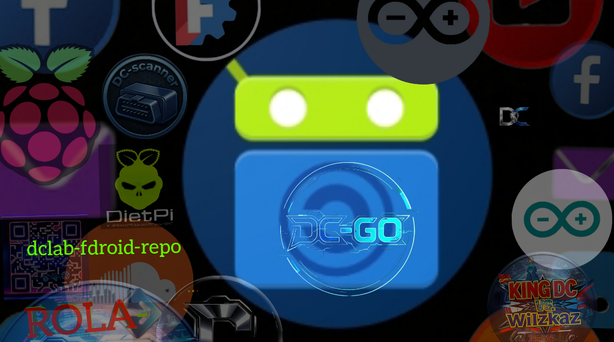

---

  

# 📱 DC LAB — Repositorio F-Droid

  

  <strong>Aplicaciones de código abierto · Hecho en DC LAB</strong> 
  Disponibles directamente desde F-Droid

---

  
  
  
  

---

## 📲 Cómo agregar este repositorio

1. Abre **F-Droid** en tu dispositivo Android
2. Ve a **Ajustes → Repositorios de aplicaciones**
3. Toca el botón **+**
4. Pega esta dirección:
   > `https://dcg0.github.io/dclab-fdroid-repo/repo`
5. Toca **Añadir** ✅

---

## 📦 Aplicaciones Disponibles

| App | Descripción | Versión |
|-----|-------------|---------|
| 🚗 **DC Scanner** | Escáner OBD2 para diagnóstico automotriz | v1.0 |

---

  <em>© 2026 DC LAB — Código Abierto · Hecho con ❤️</em>

